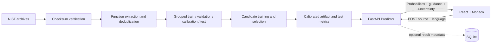

# Architecture and API contract

The browser sends a source string and an explicit language to FastAPI. A startup-loaded `Predictor` uses the saved TF-IDF pipeline and calibrated classifier. It returns class probabilities, an optional accepted class, and abstention reasons. Category guidance adds educational context; it does not change the model prediction. No source code is executed.

## API

| Method | Path | Behavior |
|---|---|---|
| GET | `/api/health` | 200 liveness, with model readiness and history status |
| POST | `/api/predict` | 200 inference, 422 invalid input/language, 413 request >100 KB, 503 unavailable model |
| GET | `/api/model-info` | Saved model metadata and real evaluation; 503 if unavailable |
| GET | `/api/categories` | Five category descriptions and mitigations |
| GET | `/api/history` | `{enabled, scans, summary}`; latest 100 result-only records plus totals across all saved results |
| DELETE | `/api/history/{id}` | 204 deleted, 404 disabled/not found |

Prediction request: `{"code":"void example() { ... }", "language":"c"}`. Languages are `c`, `cpp`, `java`. Maximum source length is 20,000 characters. Browser file uploads have an additional 20 KB limit.

Prediction response includes `predicted_category`, nullable `class_id`, `leading_class_id`, calibrated `confidence`, five `probabilities`, `uncertain`, `uncertainty_reasons`, `explanation`, heuristic `severity`, empty `highlighted_lines`, localization note, model version, and optional history ID. Abstention never returns class 4 as a fallback. Explanations for uncertain results describe the leading hypothesis only.

The browser uses same-origin `/api` routes through Vite in development and nginx in Docker. `VITE_API_URL` can override this at build time. CORS origins are explicit. SQLite is optional and does not block basic inference when disabled.

Source is not included in logs, validation errors, history, or exception responses. Artifacts are trusted executable serialization: never load joblib files supplied by an untrusted party. The checksum detects corruption, not a malicious party who can replace both model and metadata.

This deployment is local and single-user. Authentication, rate limiting, TLS, concurrent-load validation, and multi-tenant isolation are deployment work beyond this research baseline.
